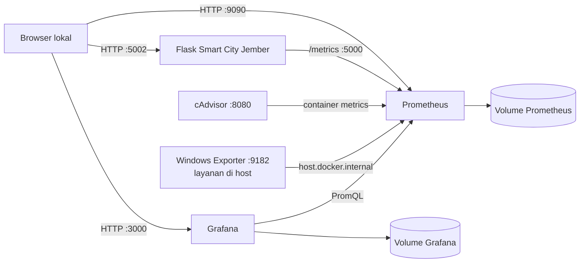

# Dokumentasi Arsitektur Elastic Shield — Smart City Jember

## 1. Pendahuluan

Dokumen ini mencatat penambahan observability pada aplikasi Flask Smart City Jember
yang sudah ada. Halaman sensor, data simulasi, dan endpoint aplikasi dipertahankan.
Stack baru ditambahkan sebagai Compose terpisah agar tidak mengganti deployment lama.

## 2. Tujuan

- Mengekspos metrik aplikasi Flask menggunakan Prometheus.
- Mengumpulkan metrik aplikasi, container, dan (setelah host exporter dipasang) Windows.
- Menampilkan metrik melalui dashboard Grafana yang diprovisikan otomatis.
- Menyediakan load test bertahap tanpa menjalankannya otomatis.
- Menjelaskan batasan scaling dari deployment Docker Compose lokal.

## 3. Teknologi yang digunakan

- Python 3.12, Flask, dan `prometheus-flask-exporter`.
- Docker Compose dengan Prometheus, Grafana, dan cAdvisor.
- Windows Exporter sebagai layanan host Windows yang di-scrape Prometheus.
- Python Requests dan `ThreadPoolExecutor` untuk load test lokal.

Image layanan monitoring dikunci ke tag versi spesifik di
`compose.elastic-shield.yaml`. Aplikasi memakai Dockerfile proyek yang ada.

## 4. Arsitektur sistem



Compose membuat bridge network khusus `elastic-shield-network`. Hanya port lokal
loopback yang dipublikasikan ke host. Aplikasi lama di port 5000 dan layanan lain
yang ditemukan pada port 5001 tidak diubah; stack ini memakai port 5002.

## 5. Integrasi Docker

Jalankan dari folder proyek di PowerShell:

```powershell
Copy-Item .env.example .env
notepad .env
docker compose -f compose.elastic-shield.yaml config
docker compose -f compose.elastic-shield.yaml up -d --build
```

Isi `GRAFANA_ADMIN_PASSWORD` di `.env` dengan password unik sebelum `up`. File `.env`
diabaikan oleh Git dan Docker build context. Jangan memasukkan kredensial ke source
code atau membagikan file `.env`.

Untuk memeriksa status dan log:

```powershell
docker compose -f compose.elastic-shield.yaml ps
docker compose -f compose.elastic-shield.yaml logs --tail 100
```

Untuk berhenti tanpa menghapus data:

```powershell
docker compose -f compose.elastic-shield.yaml down
```

Jangan gunakan `down -v`: Prometheus dan Grafana menyimpan data pada persistent
volumes `elastic-shield-prometheus-data` dan `elastic-shield-grafana-data`.
Compose baru tidak memasang, menghapus, atau mengubah volume PostgreSQL yang sudah ada.

## 6. Implementasi Prometheus

Flask menyediakan `/metrics` melalui `prometheus-flask-exporter`; endpoint lama `/`
dan `/health` tetap tersedia. Konfigurasi `monitoring/prometheus.yml` melakukan scrape
setiap 5 detik untuk Prometheus sendiri, aplikasi Flask, cAdvisor, dan Windows Exporter.
Retensi TSDB ditetapkan 15 hari.

Metrik utama Flask mencakup:

- `flask_http_request_total` — jumlah request dengan label status, method, dan endpoint.
- `flask_http_request_duration_seconds` — histogram durasi request.
- `smart_city_jember_app_info` — informasi versi aplikasi.
- Metrik proses Python, termasuk CPU dan resident memory.

## 7. Implementasi Grafana

Provisioning otomatis tersedia di `monitoring/grafana/provisioning/`. Data source
Prometheus memakai UID `prometheus`, sedangkan dashboard JSON berada di
`monitoring/grafana/dashboards/elastic-shield.json`.

Nama dashboard **Smart City Jember - Elastic Shield Monitoring**. Dashboard memuat:

1. CPU proses Flask.
2. RAM proses Flask.
3. HTTP request rate.
4. Response time p95.
5. Laju request menurut status HTTP.
6. CPU container dari cAdvisor.
7. Memori container dari cAdvisor.
8. CPU host Windows.
9. Memori host Windows.

Dashboard diatur refresh 5 detik dan rentang waktu 15 menit. Panel Windows baru
menampilkan data setelah Windows Exporter tersedia dan target scrape berstatus `UP`.

## 8. Monitoring CPU dan RAM

- Metrik proses Flask `process_cpu_seconds_total` dan
  `process_resident_memory_bytes` memberi konteks penggunaan proses aplikasi.
- cAdvisor menyediakan metrik CPU dan working set memory container Docker.
- Windows Exporter v0.32.1 memberi metrik CPU dan memori host; konfigurasi scrape
  mengarah ke `host.docker.internal:9182`.
- cAdvisor membutuhkan akses baca ke informasi Docker/Linux host. Mount yang dipakai
  dibatasi read-only. Ketersediaan metrik cAdvisor bergantung pada konfigurasi Docker
  Desktop dan Linux VM-nya. Pada pemeriksaan Docker Desktop ini, cAdvisor menyediakan
  seri berlabel `name` dan `image`; dashboard menampilkan container dengan nama
  `elastic-shield-*` agar tidak mencampur container stack lain pada host.

## 9. Load Testing

`load_test.py` memakai Requests dan `ThreadPoolExecutor`. Preset:

| Skenario | Virtual users | Durasi |
|---|---:|---:|
| Normal | 20 | 30 detik |
| Medium | 50 | 30 detik |
| High | 100 | 60 detik |

Target, jumlah pengguna, durasi, dan timeout dapat diatur lewat argumen CLI. Setiap
request memiliki timeout; target dibatasi ke `localhost`/loopback dan batas custom
adalah 100 user serta 60 detik. Script mencatat total, successful (status 2xx/3xx),
failed, waktu aktual, dan requests/second. Mulai dari skenario Normal dan evaluasi
dampak sebelum meningkatkan beban. Pengujian ini tidak dijalankan otomatis.

Contoh (jalankan secara manual setelah menyetujui target dan beban):

```powershell
py .\load_test.py --url http://127.0.0.1:5002/ --scenario normal
```

## 10. Hasil pengujian aktual

Hasil load test belum tersedia karena skenario trafik tidak dijalankan. Jangan
mengisi tabel ini dengan angka perkiraan.

Pemeriksaan smoke test stack dilakukan setelah deployment lokal:

| Pemeriksaan | Hasil |
|---|---|
| Flask `/`, `/health`, dan `/metrics` | HTTP 200; metrik request dan info aplikasi ditemukan |
| Prometheus readiness | HTTP 200 |
| Target Prometheus Flask, cAdvisor, Prometheus | `UP` |
| Grafana health, data source, dashboard terprovisi | Berhasil |
| cAdvisor endpoint dan seri CPU/memori | HTTP 200; seri CPU/memori per container tersedia |
| Windows Exporter | `DOWN`; layanan exporter belum dipasang pada host |
| Load test | Tidak dijalankan |

| Skenario | Total | Sukses | Gagal | Req/s | Catatan |
|---|---:|---:|---:|---:|---|
| Normal | Belum diuji | — | — | — | Jalankan manual dan catat output aktual |
| Medium | Belum diuji | — | — | — | Jalankan setelah meninjau skenario Normal |
| High | Belum diuji | — | — | — | Jalankan setelah meninjau skenario Medium |

Validasi konfigurasi dan pemeriksaan runtime yang benar-benar dilakukan dicatat pada
ringkasan penyelesaian tugas, bukan diklaim sebagai load-test.

## 11. Evaluasi Rapid Elasticity

Prometheus mengamati perubahan request rate, p95 response time, CPU, dan memori.
Grafana menyajikan metrik tersebut untuk membantu operator mengenali kenaikan beban.
Prometheus/Grafana sendiri tidak menambah replika aplikasi.

Docker Compose pada satu host tidak menyediakan autoscaling otomatis, health-aware
load balancing untuk replika, atau kapasitas multi-host. Menambah jumlah container
secara manual tidak cukup untuk skala jika port host atau konfigurasi network tetap
konflik. Untuk demonstrasi lokal, skala aplikasi secara manual hanya setelah desain
reverse proxy/load balancer dan batas resource diuji.

Pengembangan lanjutan:

- **Docker Swarm:** deploy service dengan beberapa replika, publish melalui routing
  mesh, pasang health checks/resource limits, dan gunakan mekanisme scaling eksternal
  atau orkestrasi untuk mengubah replica count.
- **Kubernetes:** jalankan Deployment + Service/Ingress; gunakan HPA dengan metrik
  resource dan metrics-server, serta Prometheus Adapter bila autoscaling berbasis
  metrik aplikasi diperlukan.

Kedua rancangan tersebut belum dikonfigurasi atau diuji di proyek ini. Autoscaling
belum aktif dan tidak ada klaim kapasitas tertentu.

## 12. Keamanan sistem

- Grafana password diberikan melalui `.env`, bukan disimpan dalam source code.
- `.env` diabaikan Git dan Docker build context; gunakan secret manager di produksi.
- Grafana, Prometheus, cAdvisor, dan aplikasi baru hanya dipublikasikan ke loopback.
- Windows Exporter harus dibatasi firewall ke jaringan lokal/host Docker.
- Jangan mengekspos endpoint `/metrics` dan UI monitoring langsung ke internet.
- Deployment publik memerlukan reverse proxy, HTTPS/TLS, autentikasi dan kebijakan
  firewall yang sesuai. Pertimbangkan pembatasan akses ke `/metrics`.
- cAdvisor memerlukan visibilitas terhadap resource Docker; pertahankan mount read-only
  dan jangan menambahkan hak istimewa yang tidak dibutuhkan.

## 13. Pengelolaan data

Prometheus menyimpan time-series pada volume `elastic-shield-prometheus-data` dengan
retensi 15 hari. Grafana menyimpan state pada `elastic-shield-grafana-data`.
`docker compose down` mempertahankan volume. Hindari penghapusan volume saat
troubleshooting. Aplikasi lama dan volume PostgreSQL yang ditemukan tidak diubah.

## 14. Kesimpulan

Elastic Shield menambahkan instrumentasi Flask dan stack observability terpisah,
mempertahankan route serta UI sebelumnya, dan menyediakan dashboard serta alat uji
beban. Kondisi target Windows Exporter/cAdvisor perlu divalidasi pada host yang
menjalankan stack. Autoscaling produksi memerlukan orkestrator dan belum tersedia di
Compose lokal ini.

## 15. Lampiran screenshot

Ambil screenshot aktual berikut saat stack berjalan; jangan mengganti screenshot
dengan mockup:

1. Halaman Smart City Jember tetap terbuka pada `http://localhost:5002`.
2. Endpoint `/metrics` menunjukkan metrik Flask.
3. Prometheus **Status > Targets**, dengan status setiap target yang benar-benar ada.
4. Dashboard Grafana penuh dengan rentang 15 menit dan refresh 5 detik.
5. Panel CPU/RAM container dari cAdvisor.
6. Panel CPU/RAM Windows setelah host exporter `UP`.
7. Terminal berisi output aktual skenario load test yang dijalankan manual.
8. `docker compose ps` untuk menunjukkan kondisi layanan.

Simpan tanggal/waktu dan skenario pada keterangan laporan. Jika target host belum
tersedia, tampilkan statusnya apa adanya dan jangan menyatakan metrik tersebut aktif.
